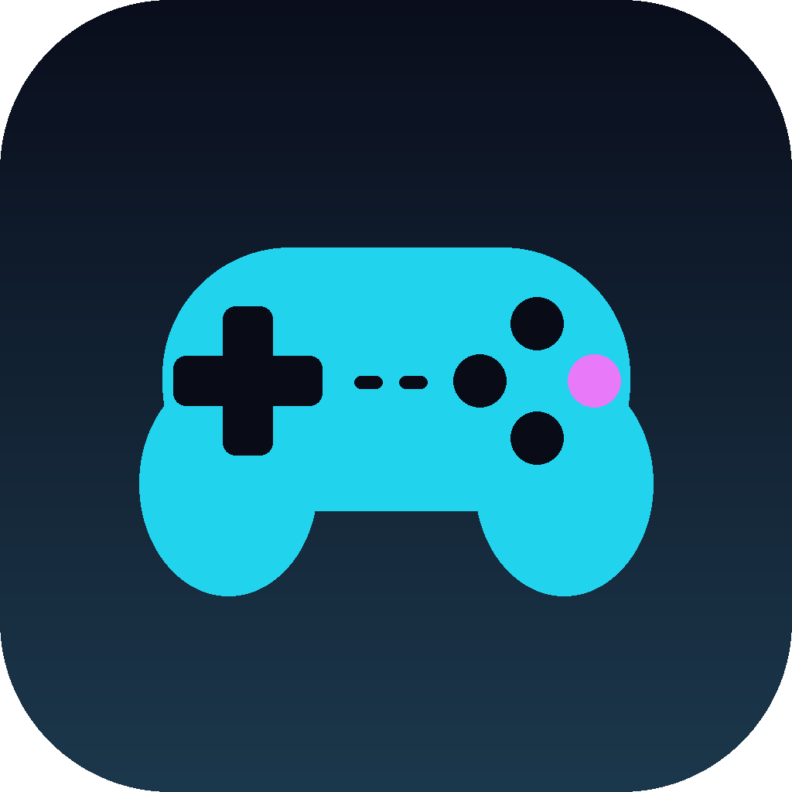

<p align="center">
  
</p>

<h1 align="center">Arcade Hub</h1>

<p align="center"><b>All your PC games and emulated consoles in one Windows launcher — with TV Mode, console-style skins, trailers, achievements, P2P online play and smart DualSense haptics.</b></p>

**All your games — Steam, Epic, GOG, standalone PC games and emulated consoles — in one launcher for Windows, built to be used from the couch with a controller or at the desk with a mouse.**

Arcade Hub scans your PC, puts every game in a single library with covers, info, trailers and playtime, and opens each one the right way: through its store, directly from the `.exe`, or in the right emulator with the right ROM. It also ships with **DualSense Auto** (smart vibration and adaptive triggers for any PC game) and a full-screen **TV Mode** that turns the PC into a console.

The interface is available in **Português (Brasil), English, Español, 日本語 and 简体中文**.

---

## Download

1. Open the [latest release](https://github.com/alphagunsmith/Arcade-Hub/releases/latest).
2. Download `Arcade-Hub-<version>-setup.exe` and run it.
3. The installed version **updates itself**: new versions are downloaded in the background and installed when you restart the app.

A portable `.exe` and a `.zip` are also published with each release (these don't auto-update).

> Requirements: Windows 10 or 11, 64-bit. The installer isn't code-signed, so Windows SmartScreen may show "Windows protected your PC" the first time — click **More info › Run anyway**.

## Features

### One library for everything
- **Automatic scan** of Steam, Epic Games and GOG Galaxy installs, your game folders (portable `.exe` games) and your ROM folders. New games show up on their own when a folder changes.
- **ROMs from dozens of systems** — NES, SNES, N64, Game Boy / Color / Advance, DS, 3DS, GameCube, Wii, Wii U, Switch, Master System, Mega Drive, Game Gear, PC Engine, PlayStation 1/2, PSP, Saturn, Dreamcast, Atari, Commodore 64, Neo Geo Pocket, WonderSwan, arcade and more. The platform is detected from the file extension and folder.
- **Add anything by hand**: an `.exe`, a ROM, a store link (`steam://…`) or a website.
- **Uninstalled games leave the library on their own**, and come back with their playtime, cover and achievements if you reinstall them. A one-click cleanup removes games whose files are gone.
- Search, favorites, filters by platform / store / genre / score, sorting, grouping and a "random game" button.

### Covers, info and trailers
- **Covers** from Steam and the Libretro collection out of the box; optionally from SteamGridDB (free key) for community art, or pick an image from your PC.
- **Game info**: description, developer, year, genres and Metacritic score (Metacritic, Wikidata and Steam).
- **Trailers that play instantly** behind the selected game — streamed from Steam and cached, with optional YouTube and ScreenScraper sources for console games and ROMs. Strict matching avoids movie trailers for games that share a name with a film; if a game has no trailer, it simply shows none.

### Looks: skins and console dashboards
- Seven library layouts — **grid**, **carousel (rondel)**, **list** (genre, playtime, last played), **compact**, **shelf**, **rows** (continue playing, favorites, each store) and **mosaic** (favorites and most played stand out) — plus more than 40 skins: color themes inspired by classic consoles, **console dashboards** (XMB, Xbox 360 blades, Wii/Wii U channels, Xbox One tiles, Switch row, GameCube/3DS carousels), RGH-style dashboards (Aurora, FreeStyle Dash, XeXMenu) and **LaunchBox / Big Box**-style views (box wall, vertical wheel, text list, detailed table).
- Layout and color are independent and saved.
- **Animated backgrounds** in the style of each console (the PS3 wave, PS2 towers, Xbox 360 orbs, the GameCube cube…), drawn live in the skin's colors — original art, no copied footage. They pause by themselves while you play.
- **Skin creator**: build a palette from one color, take the colors from an image or let it surprise you; pick an animated background or use your own image, GIF or video; choose the font, corners, CRT effect and console layout; live preview with an automatic contrast fix. Export and import skins as `.arcadeskin` files.

### TV Mode and Console Mode
- **TV Mode**: a full-screen, controller-first interface (Guide button or the TV icon) with home, library, achievements, stats, emulators and system sections.
- TV Mode uses your skin's colors and background, and has **exclusive wheel skins** (glass, neon, retro): game logos on a half circle on the right, the trailer on the left and, next to it, a 3D spinning game box or a character PNG you choose for each game.
- **Console Mode**: start Arcade Hub with Windows straight into TV Mode, with sleep / restart / shut down from the controller.
- Works with Xbox, PlayStation and generic controllers (D-pad / stick to move, A to open, X to play, B to go back) as well as keyboard and mouse.

### Profiles, playtime and achievements
- **Playtime** is counted for every game opened through Arcade Hub — including store games and games that run elevated.
- **Local profiles** for everyone at home ("Who's playing?"), each with their own playtime and **22 achievements** (bronze to platinum), plus statistics by month, platform and source.

### Play online with friends (P2P, no server)
- **Invite codes**: for retro games, **Play online** hosts a **RetroArch netplay** match and creates an invite code (and an `arcadehub://` link) to send through any messenger. Your friend pastes it in **Play online… › Join with code** — Arcade Hub checks that both sides have the same ROM and connects directly between the two PCs.
- **Password per match**, carried inside the code, so only invited friends can join.
- **Automatic router port opening (UPnP)** through RetroArch, **games on your home network** listed automatically, and an optional **RetroArch relay** (São Paulo, New York or Madrid) for networks where a direct connection isn't possible (mobile internet, CGNAT).
- **Discord** works too: Rich Presence shows what you're playing and friends can click **Join** on Discord to enter the same match. Everything goes through the Discord app on each PC.

### DualSense Auto (built in)
Smart vibration and adaptive triggers for **any PC game**, bundled and managed by Arcade Hub (Settings › DualSense, or the ≡ menu):
- **Virtual Xbox controller**: games see an Xbox pad, and the vibration they send is turned into DualSense haptics. Your trigger use is combined with game rumble to tell your own shots from hits you take.
- **Optional AI vision** (your own Claude API key): reads the screen to recognize the weapon in hand, weather, terrain under the wheels, damage direction and low health, and sets up the triggers for each weapon.
- **Our own mods for CoD: Infinite Warfare, Titanfall 2 (Northstar), classic Doom (GZDoom) and CoD: Black Ops II (Plutonium)**: the game itself reports the weapon in hand, every shot, the magazine, damage and health — no AI needed. **Per-weapon setup**: each weapon gets its own triggers from its real data (fire rate, magazine, energy or ballistic, burst, bolt-action), and a **Weapons** tab lets you fine-tune any weapon from any game.
- **Mod support**: works with mods made for the DSX protocol (e.g. Cyberpunk 2077), downloads and installs mods from Nexus Mods (with requirements and backups of replaced files), and installs mods you already downloaded — including FOMOD installers. It finds the game folder through Steam, Epic, GOG **and your Arcade Hub library**.
- Starts and stops with Arcade Hub; if Arcade Hub closes unexpectedly, DualSense Auto shuts down cleanly and returns the triggers to normal.

### Your data
- Everything lives in one `library.json` in `%APPDATA%\Arcade Hub`, written atomically with an automatic backup copy; a damaged file is recovered from the backup.
- **Backup / restore** the whole library (with cover images) as a single `.zip`.
- API keys and passwords are encrypted with Windows (DPAPI) and are never included in backups.

## Languages

By default Arcade Hub **follows your Windows display language** (read from Windows' preferred languages every time it starts); any language other than Portuguese, Spanish, Japanese and Chinese falls back to English. To pin a language, choose it in **Settings › General › Language** (or in TV Mode › System).

## Online services used

Arcade Hub has no account and no telemetry. It only talks to services when a feature needs them:

| Service | When |
|---|---|
| Steam store / Libretro | covers, game info and trailers |
| Metacritic, Wikidata | scores and game info |
| SteamGridDB, YouTube, ScreenScraper | only if you add your own key / account |
| GitHub | checking for and downloading updates (installed version) |
| Discord (local app) | Rich Presence and invites, if Discord is open |
| api.ipify.org | finding your public address when hosting an online match |
| lobby.libretro.com and RetroArch relay servers | only when you choose the RetroArch relay for online play |
| Anthropic API, Nexus Mods | DualSense Auto, only with your own keys |

## Building from source

```bash
npm install
npm start          # run in development
npm test           # test suite (also runs on Windows and Linux in CI)
npm run dist       # build the Windows installer, portable and zip
```

DualSense Auto is written in Python (`dualsense/`). The release workflow builds it into `DualSenseAuto.exe` on Windows with `python dualsense/empacotar.py` (Python 3.12 with `numpy psutil mss pyinstaller`), and electron-builder bundles it under `resources/dualsense`. In development, set `ARCADE_DUALSENSE=1` to run it from source.

Releases are published automatically by GitHub Actions when the `version` in `package.json` changes and all tests pass.

### Translations

Texts are written in Portuguese in the code. Translations live in `i18n/textos/*.tsv` (one line per text: Portuguese, English, Spanish, Japanese, Simplified Chinese; `{0}`, `{1}` mark variable parts). After editing, run:

```bash
node i18n/gerar.js
```

The test suite fails if the generated dictionaries are out of date or if a translation is missing a placeholder.

## License

MIT
